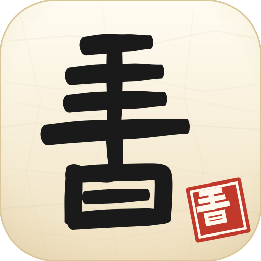

# ScribeVG

A Windows touchscreen app for practicing kanji handwriting. Write each stroke and ScribeVG checks its order, direction and shape against [KanjiVG](https://kanjivg.tagaini.net) stroke data, then schedules reviews with spaced repetition.

## Features

- Stroke-by-stroke scoring with a stroke-order guide (hold Space to peek)
- Study mode with FSRS spaced repetition and up to 10 new kanji a day, ordered by old JLPT level, school grade and frequency
- A kanji unlocks only after you've learned its parts (水 before 氷)
- Sheet mode, like a practice notebook: one traced rep, two faded reps, then three from memory
- Meanings stay hidden until you finish, so you have to recall them
- Example sentences for about 1,900 kanji
- Tap the big kanji for a speech bubble with an example sentence, and Emi's voice when a clip is available
- Auto-advance, visual feedback and a practice-paper look

## Install

Install from **[ppdac.ltd/scribevg](https://ppdac.ltd/scribevg/)** and ScribeVG updates itself: it checks for a new version each time it starts. The Install link works directly in Edge; in Chrome or Firefox, open the downloaded file or use `setup.exe` from the same page. It installs for your Windows account only, with no admin rights needed. The app isn't code-signed yet, so Windows will say the publisher is unknown. Your progress is kept in `%AppData%\ScribeVG` and carries over between updates.

## Download

Prefer a portable copy? Get the latest Windows build from [Releases](https://github.com/soyfrien/ScribeVG/releases). It's self-contained, so you don't need to install .NET; just unzip and run `ScribeVG.exe`.

## Build

You need the .NET SDK with Windows desktop support:

    dotnet build ScribeVG/ScribeVG.csproj

## Credits

- Stroke data: [KanjiVG](https://kanjivg.tagaini.net) by Ulrich Apel and contributors, CC BY-SA 3.0
- Kanji meanings, readings and grades: [KANJIDIC2](https://www.edrdg.org/wiki/index.php/KANJIDIC_Project) from the Electronic Dictionary Research and Development Group, CC BY-SA 4.0
- Example sentences: the [Tatoeba Project](https://tatoeba.org), CC BY 2.0 FR

## License

The code is MIT; see `LICENSE.txt`. The bundled data keeps the licenses listed above.
